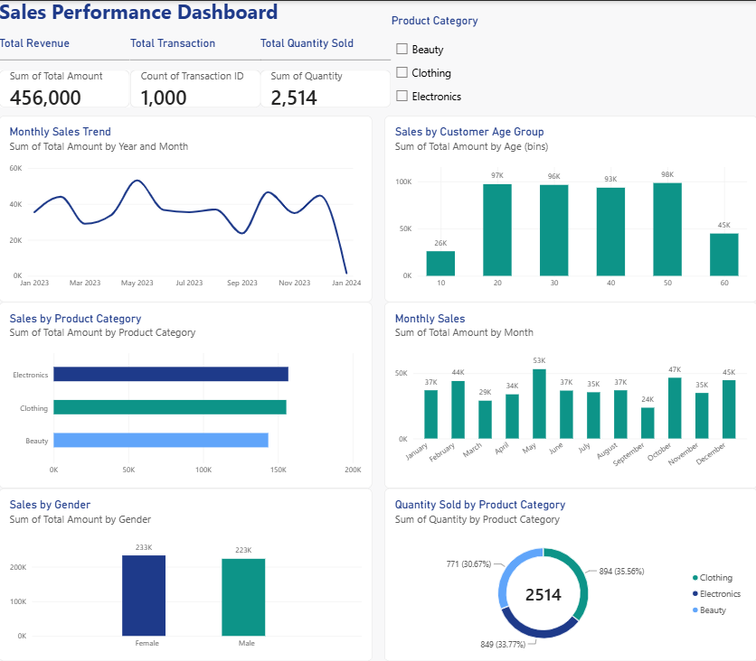

# Retail Sales Performance Dashboard | Power BI

## Project Overview

This project focuses on analyzing retail sales data using Microsoft Power BI. The goal was to transform raw sales data into an interactive dashboard that provides a clear overview of sales performance, product categories, customer demographics, and sales trends.

The dashboard allows users to explore sales information through interactive slicers and visualizations.

## Dashboard Preview



## Dataset

The project uses a retail sales dataset containing 1,000 transactions and the following information:

- Transaction ID
- Date
- Customer ID
- Gender
- Age
- Product Category
- Quantity
- Price per Unit
- Total Amount

## Tools & Technologies

- Microsoft Power BI
- Power Query
- Data Cleaning and Transformation
- Data Visualization
- Interactive Slicers and Filters

## Key Dashboard Features

### Sales Overview

- Total Revenue
- Total Transactions
- Total Quantity Sold

### Sales Trend Analysis

- Monthly sales performance
- Sales trends over time

### Product Category Analysis

- Revenue comparison across product categories
- Category-based sales performance

### Customer Analysis

- Sales by gender
- Customer age analysis

### Interactive Dashboard

- Product category slicer
- Date and other interactive filters
- Dynamic filtering across dashboard visuals

## Project Objectives

- Understand retail sales performance
- Identify sales trends over time
- Compare revenue across product categories
- Explore customer demographics
- Develop an interactive business intelligence dashboard

## How to View the Dashboard

1. Download the `sales_performance_dashboard.pbix` file from this repository.
2. Open the file using Microsoft Power BI Desktop.
3. Interact with the dashboard using the available slicers and filters.

## Repository Structure

```text
Power-BI-Sales-Dashboard/
│
├── images/
│   └── sales_dashboard.png
│
├── sales_performance_dashboard.pbix
│
├── retail_sales_dataset.csv
│
└── README.md
```

## Learning Outcomes

Through this project, I gained practical experience in:

- Importing and preparing data in Power BI
- Creating KPI cards and interactive visualizations
- Analyzing sales trends and product categories
- Working with slicers and filters
- Designing a business intelligence dashboard for sales analysis

This project represents my practical learning journey in Data Analytics and Business Intelligence.
